# Lab 1: Build and Deploy the Contoso Air AI Travel App on AKS Automatic

**Introduction**

This workshop shows you how easy it is to deploy applications to AKS Automatic. AKS Automatic is a fully managed Kubernetes service that simplifies the deployment, management, and operations of Kubernetes clusters. Deploy a cluster with just a few steps in the Azure portal and focus on building your applications!

**Objectives**

After completing this workshop, you will be able to:

- Deploy an application to an AKS Automatic cluster

- Troubleshoot application issues

- Integrate applications with Azure services

- Scale your cluster and applications

- Observe your cluster and applications

**Architecture**

| **Component**                                                                                    | **Role in the lab**                                                                                            |
|--------------------------------------------------------------------------------------------------|----------------------------------------------------------------------------------------------------------------|
| GitHub fork of contoso-air                                                                       | Source code and GitHub Actions workflow                                                                        |
| Managed identity **workflowapp-identity** (with federated credentials) | Identity GitHub Actions uses to sign in to Azure without passwords or stored secrets |
| Azure Container Registry (ACR)                                                                   | Stores the contoso-air container image                                                                         |
| AKS Automatic cluster myakscluster                                                               | Runs the app in namespace dev                                                                                  |
| Managed identity myidentity\<xxx\>                                                               | Identity the app pod uses to call Azure OpenAI                                                                 |
| Azure OpenAI myopenai\<xxx\>                                                                     | LLM behind the AI travel assistant                                                                             |
| Log Analytics / Azure Monitor workspace                                                          | Logs and Prometheus metrics                                                                                    |
| Application Insights myappinsights\<xxx\>                                                        | App performance telemetry                                                                                      |

**Prerequisites**

- **GitHub Account**: You are expected to have your own GitHub login credentials. If you do not have an account, please create one by visiting: +++https://github.com/signup+++

## Exercise 1: Set up the lab environment

### Task 1: Prepare the Azure environment and register providers

1.  Open a browser and sign in to the Azure portal at +++https://portal.azure.com/+++ with your credentials.

| **Username** | **+++@lab.CloudPortalCredential(User1).Username+++** |
|----|----|
| **Temporary Access Pass** | **+++@lab.CloudPortalCredential(User1).AccessToken+++** |

2.  In the Azure portal, select the *Cloud Shell* icon from the top navigation bar to open Azure Cloud Shell and run commands directly from the browser.

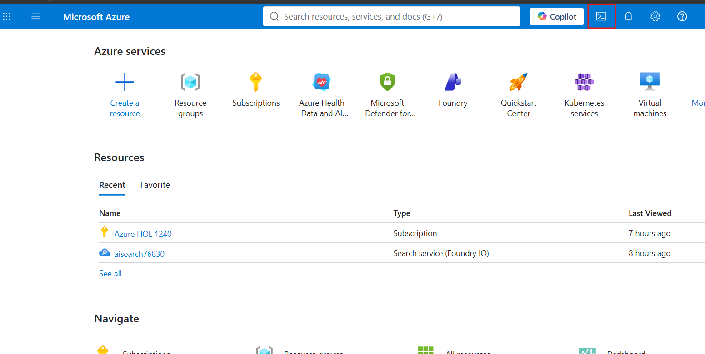

3.  In the Welcome to Azure Cloud Shell dialog, select Bash to launch a Bash session and begin running Azure CLI commands in Cloud Shell.

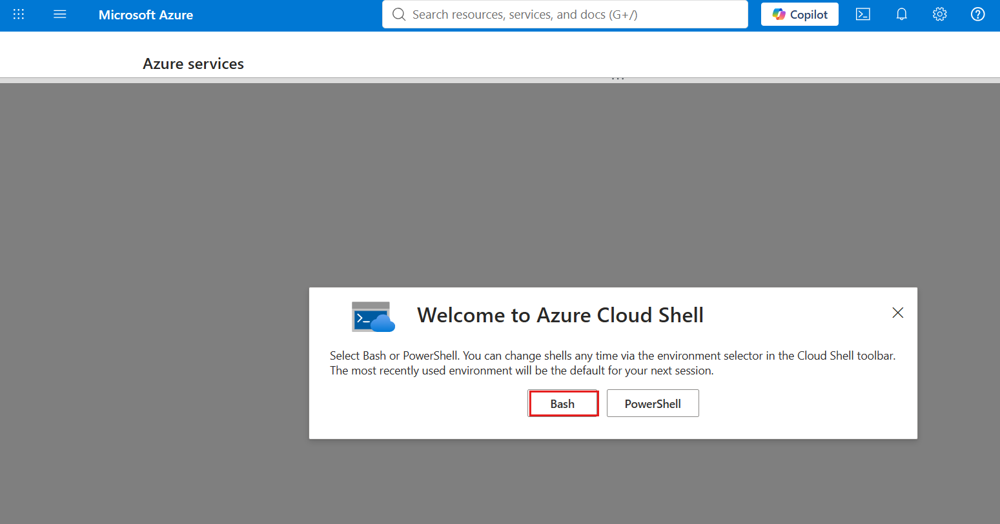

4.  Choose No storage account required, select your subscription, and then select Apply to start Cloud Shell without creating a storage account.

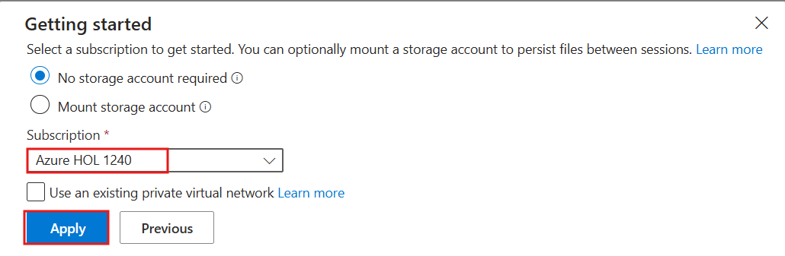

5.  In Azure Cloud Shell, run the following command. Then, open the displayed URL (https://login.microsoftonline.com/device) in a web browser, enter the **device code** shown in the terminal, and complete the **sign-in** process using your Azure account.

    +++az login --use-device-code+++

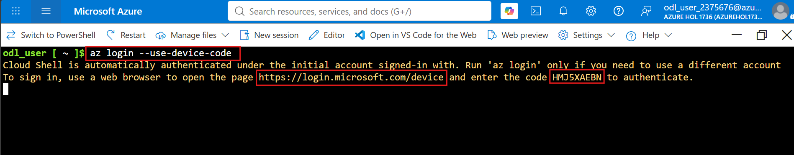

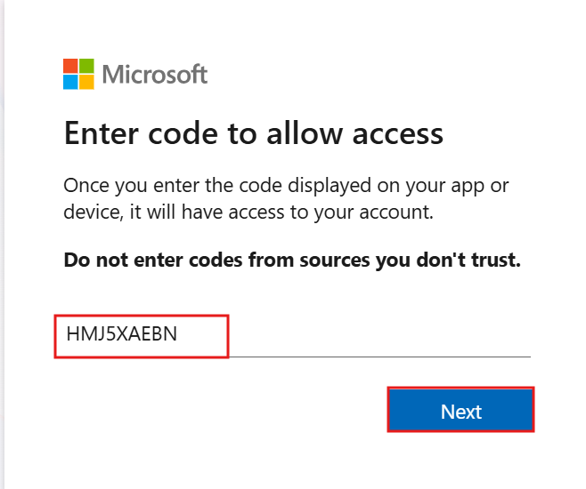

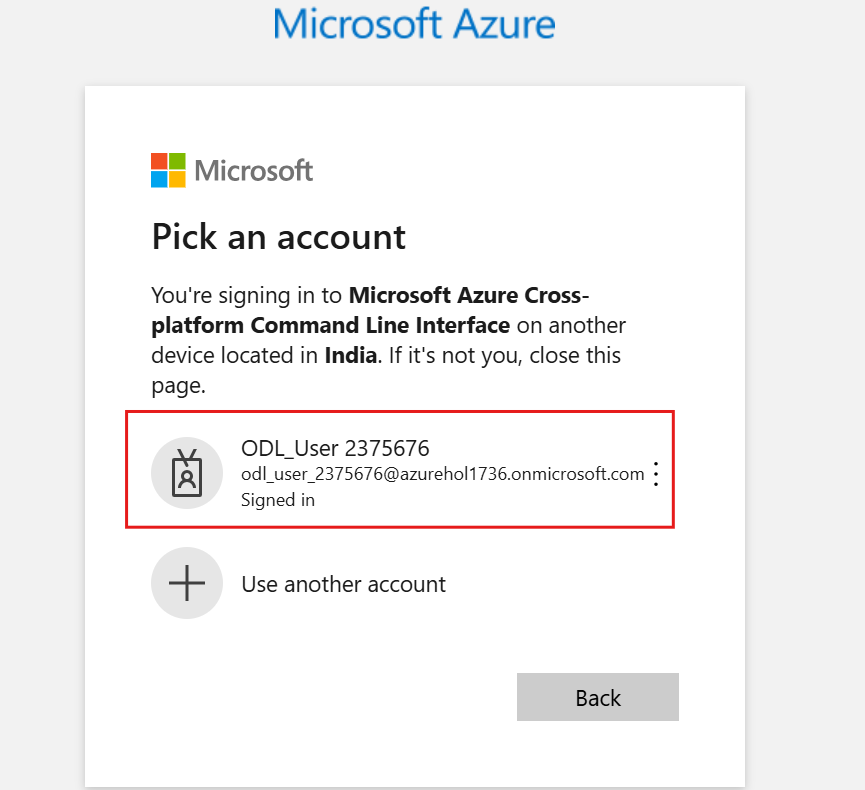

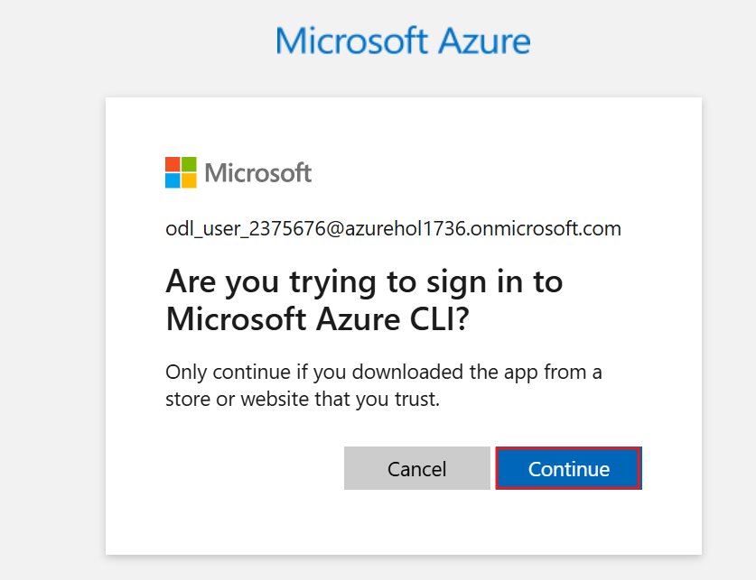

6.  Select the Azure subscription and tenant from the list, enter **1** to choose the displayed option, and then press Enter to continue.

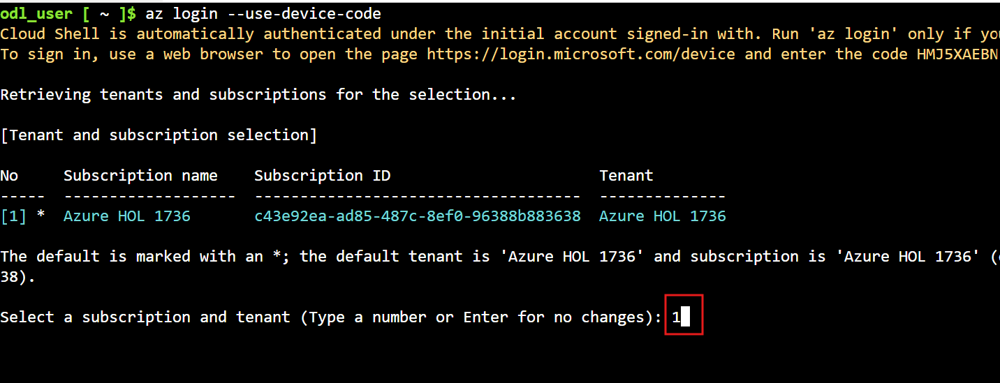

**Tip:** You can log into a different tenant by passing in the **--tenant** flag to specify your tenant domain or tenant ID.

7.  Run the following command to add the **aks-preview** Azure CLI extension.

    +++az extension add --name aks-preview+++

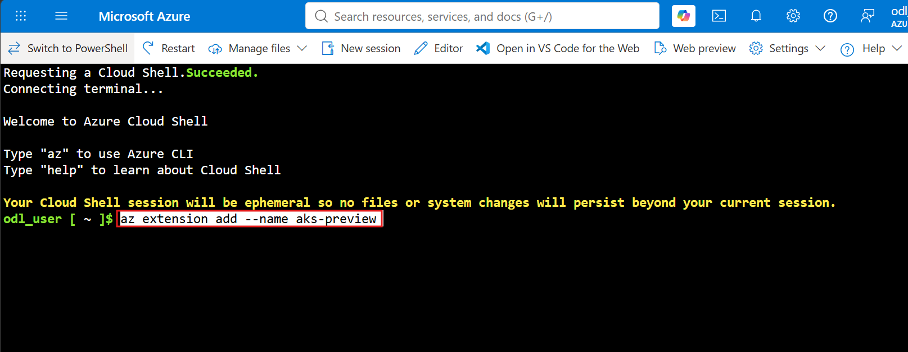

8.  Run the following command to register the application monitoring preview feature, and then verify that the registration completes successfully by confirming that the feature state is displayed as *Registered* in the command output.

    +++az feature register --namespace Microsoft.ContainerService --name AzureMonitorAppMonitoringPreview+++

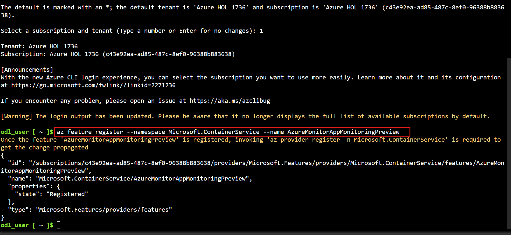

9.  Run the following commands to register the resource providers.

    +++az provider register --namespace Microsoft.DevHub+++

    +++az provider register --namespace Microsoft.Insights+++

    +++az provider register --namespace Microsoft.PolicyInsights+++

    +++az provider register --namespace Microsoft.ServiceLinker+++
    
    +++az provider register --namespace Microsoft.ContainerService+++
    
    +++az provider register --namespace Microsoft.AlertsManagement+++

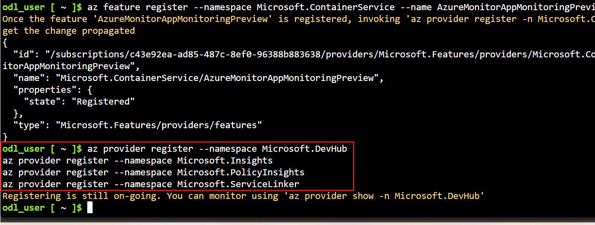

### Task 2: Use the existing resource group

This lab uses the resource group that is already provided in your lab environment. You will not create a new resource group. Instead, you will set environment variables for the existing resource group name and its location.

1.  Run the following command to list the resource groups in your subscription. Note the name of the existing resource group (for example, **ResourceGroup1**).

    +++az group list -o table+++

2.  Run the following command to set the resource group name to the existing resource group.

    +++export RG_NAME=ResourceGroup1+++

**Note:** If your resource group has a different name, replace ResourceGroup1 with the name shown in the previous step.

3.  Run the following commands to set the location to the region of the existing resource group, and then verify both values.

    +++export LOCATION=$(az group show --name $RG_NAME --query location -o tsv)+++

    +++echo "RG_NAME=$RG_NAME LOCATION=$LOCATION"+++

**Note:** The output should show the resource group name and its region (for example, RG_NAME=ResourceGroup1 LOCATION=centralus). If LOCATION is empty, check that RG_NAME matches the resource group name exactly.

### Task 3: Get your user object ID

1.  The template gives your account access to Key Vault and Azure OpenAI, so it needs your user object ID. If this value is empty, the deployment fails with **InvalidPrincipalId**. Run the following commands to get your user object ID.

```bash
export USER_ID=$(az ad signed-in-user show --query id -o tsv)
echo "USER_ID=$USER_ID"
```

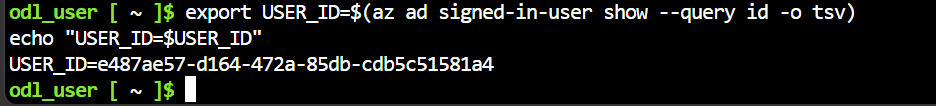

2.  If nothing is printed, use this instead (reads the ID from your sign-in token):

```bash
export USER_ID=$(az account get-access-token --query accessToken -o tsv | cut -d. -f2 | tr '_-' '/+' | base64 -d 2>/dev/null | python3 -c "import sys,json; print(json.load(sys.stdin)['oid'])")
echo "USER_ID=$USER_ID"
```

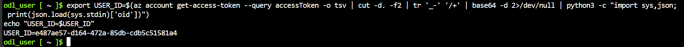

3.  In Azure Cloud Shell, save the environment variables by exporting the required values, and then verify that the variables are available for use in subsequent deployment commands.

```bash
echo "export LOCATION=$LOCATION RG_NAME=$RG_NAME USER_ID=$USER_ID" > ~/aks-lab.env
cat ~/aks-lab.env
```

**Tip:** Cloud Shell clears your variables when it restarts or times out. If that happens at any point in this lab, run **source ~/aks-lab.env** to load RG_NAME, LOCATION and USER_ID again.

### Task 4: Deploy the resources

To keep focus on AKS-specific features, this workshop requires several Azure resources to be pre-provisioned, including:

- Azure Log Analytics Workspace for container insights and application insights

- Azure Monitor Workspace for Prometheus metrics

- Azure Container Registry for storing container images

- Azure Key Vault for secrets management

- Azure User-Assigned Managed Identity for accessing Azure services via Workload Identity

- Azure Application Insights for application monitoring

- Azure OpenAI Service with a GPT model deployment for the AI chat feature

1.  Run the following command to load your environment variables and confirm that all three values are set.

    +++source ~/aks-lab.env && echo "RG_NAME=$RG_NAME LOCATION=$LOCATION USER_ID=$USER_ID"+++

**Note:** If any value is empty, repeat Task 2 and Task 3 of this exercise.

2.  Run the following command to download the ARM template that deploys the workshop resources.

    +++curl -o main.json https://raw.githubusercontent.com/azure-samples/aks-labs/refs/heads/main/docs/getting-started/aks-automatic/assets/main.json+++

3.  Run the following command to update the Application Insights API version in the template. The API version in the original template causes the Application Insights deployment to fail. No output means the command succeeded.

    +++python3 -c "import json; t=json.load(open('main.json')); [r.update(apiVersion='2020-02-02') for r in t['resources'] if r.get('type')=='Microsoft.Insights/components']; json.dump(t, open('main.json','w'), indent=2)"+++

4.  Run the following command to deploy the template into your resource group.

    +++az deployment group create --resource-group $RG_NAME --name $RG_NAME-deployment --template-file main.json --parameters userObjectId=$USER_ID+++

**Note:** Run every command in this lab as a single line. If you see the error **the following arguments are required: --resource-group/-g**, your variables are empty. Run step 1 again.

**Troubleshooting: soft-deleted Azure OpenAI account or Key Vault**

If this resource group was used for the lab before, Azure keeps the deleted Azure OpenAI account and Key Vault in a soft-deleted state. The deployment then fails with **FlagMustBeSetForRestore** (Azure OpenAI) or **ConflictError: A vault with the same name already exists in deleted state** (Key Vault). Purge the deleted resources, and then run step 4 again.

- List the deleted Azure OpenAI accounts. Note the **Name** and **Location**.

    +++az cognitiveservices account list-deleted -o table+++

- Purge the Azure OpenAI account. Replace the placeholders with the values from the previous command.

    +++az cognitiveservices account purge --name <openai-account-name> --resource-group $RG_NAME --location <location>+++

- List the deleted key vaults.

    +++az keyvault list-deleted -o table+++

- Purge the key vault. Replace the placeholder with the name from the previous command. This takes 1–3 minutes.

    +++az keyvault purge --name <key-vault-name>+++

5.  Wait until the resources are deployed. This can take around 15 minutes. Once the deployment is complete, you can navigate to the resource group in the Azure portal to view the deployed resources.

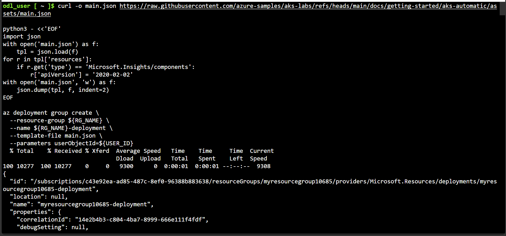

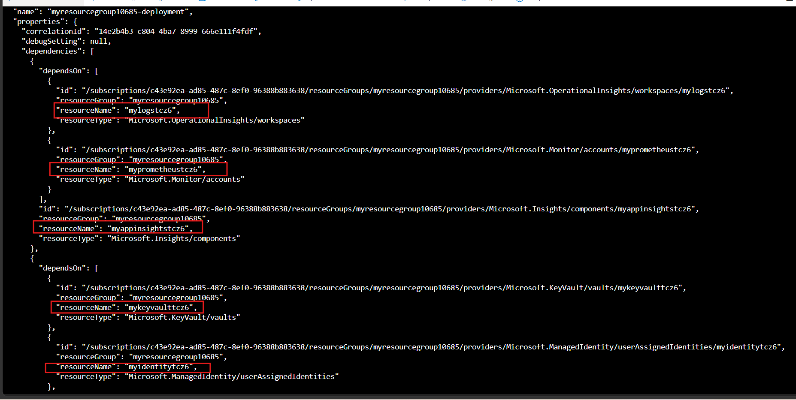

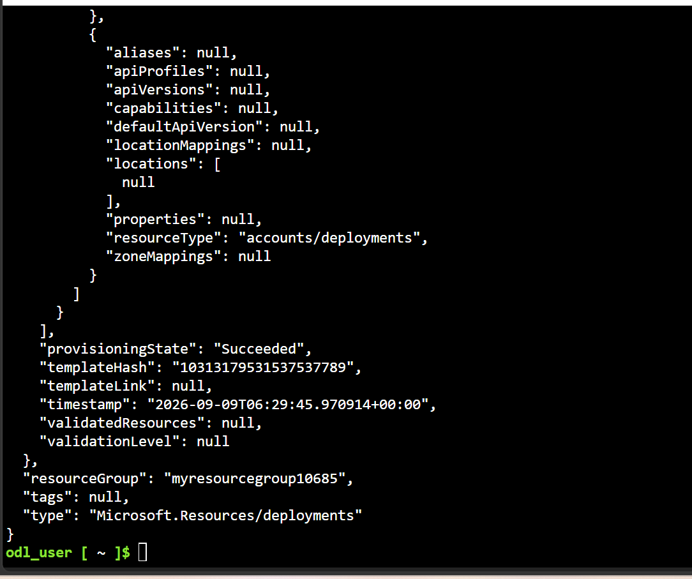

6.  In the Azure portal, open your resource group and verify that all required Azure resources have been deployed successfully in the resource group, including the Application Insights instance, Managed Identity, Key Vault, Log Analytics workspace, Azure OpenAI resource, Azure Monitor workspace, and Container Registry.

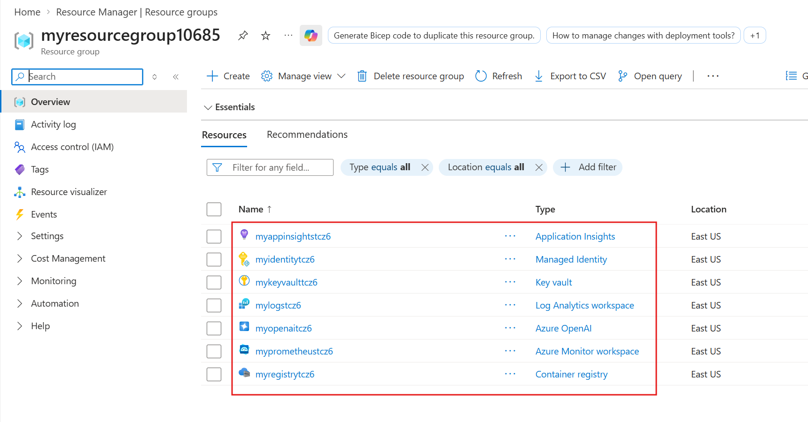

**Note:** Keep your terminal open as you will need it to run commands throughout the workshop.

### Task 5: Fork and clone the sample app

1.  In Azure Cloud Shell, run the following command, and then follow the instructions printed in the terminal to complete the login process.

    +++gh auth login+++

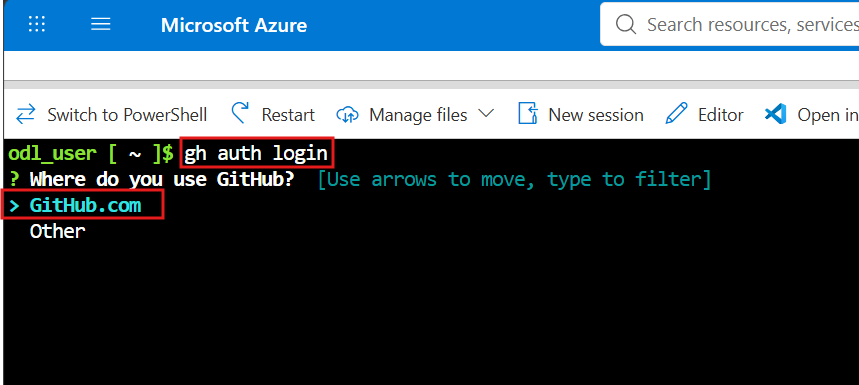

2.  Choose **HTTPS** as the preferred protocol for Git operations, enter **Y** to authenticate with your GitHub credentials, and then press Enter to continue.

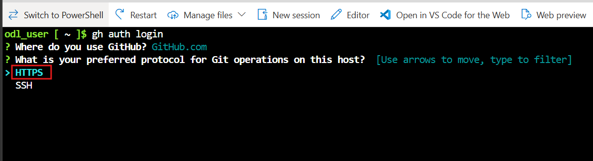

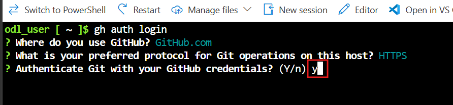

3.  In the GitHub CLI authentication prompt, select **Login with a web browser**, and then press Enter to continue the sign-in process using your web browser.

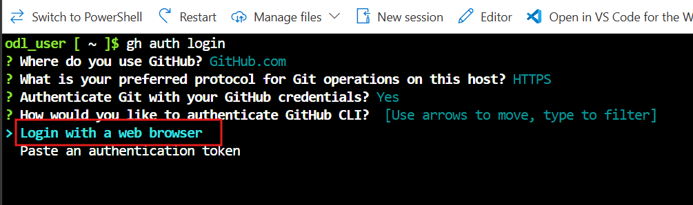

4.  In the GitHub CLI sign-in prompt, copy the one-time device code, press Enter to open https://github.com/login/device in your browser, enter the code, and complete the GitHub authentication process.

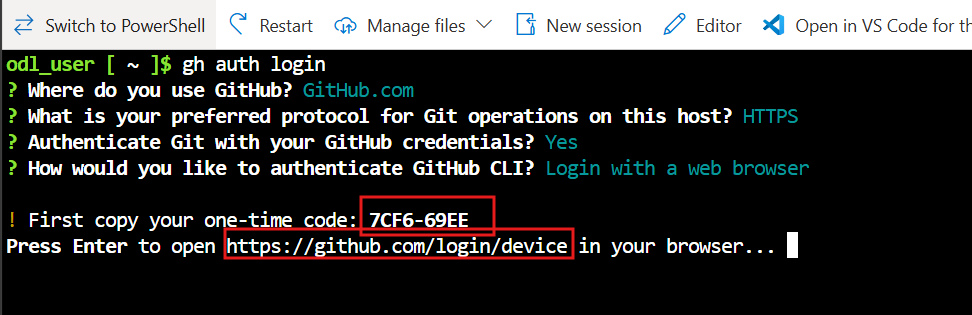

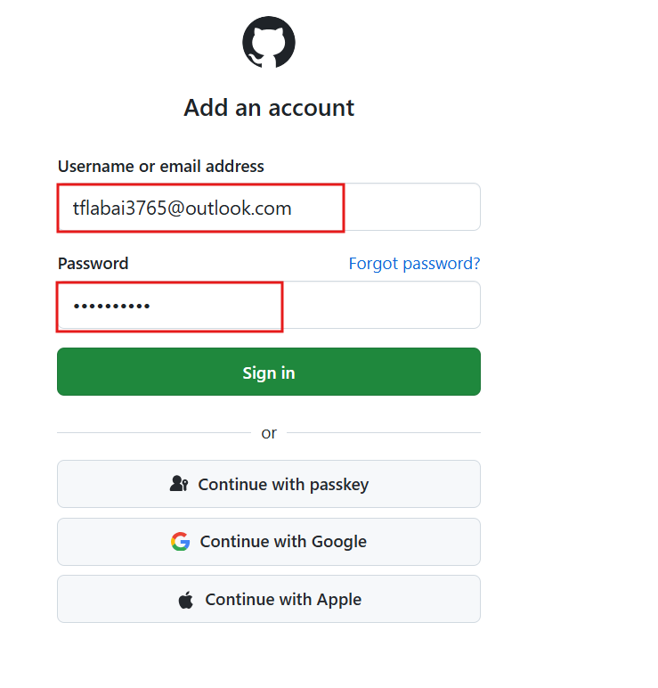

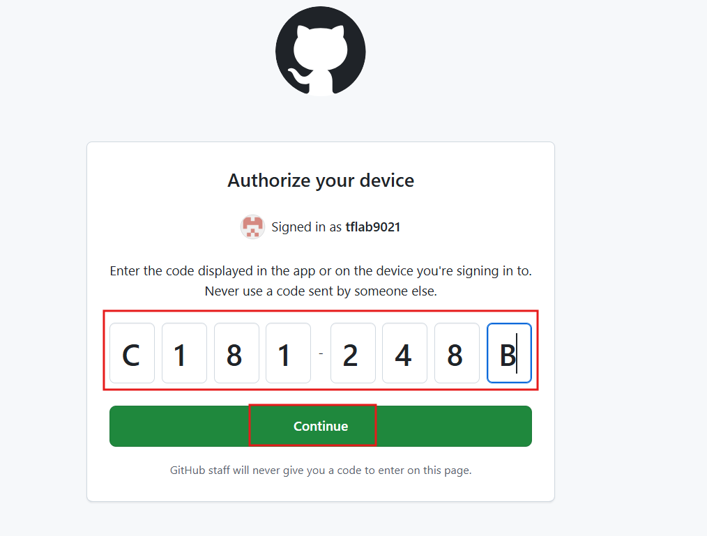

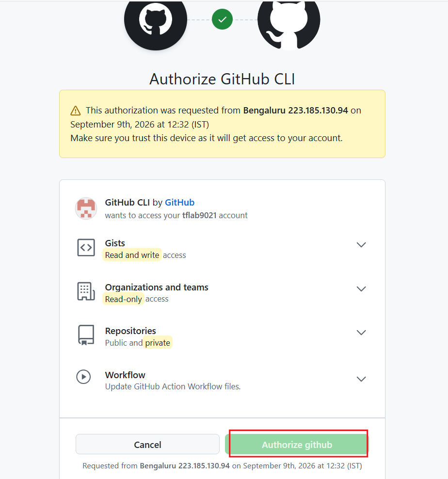

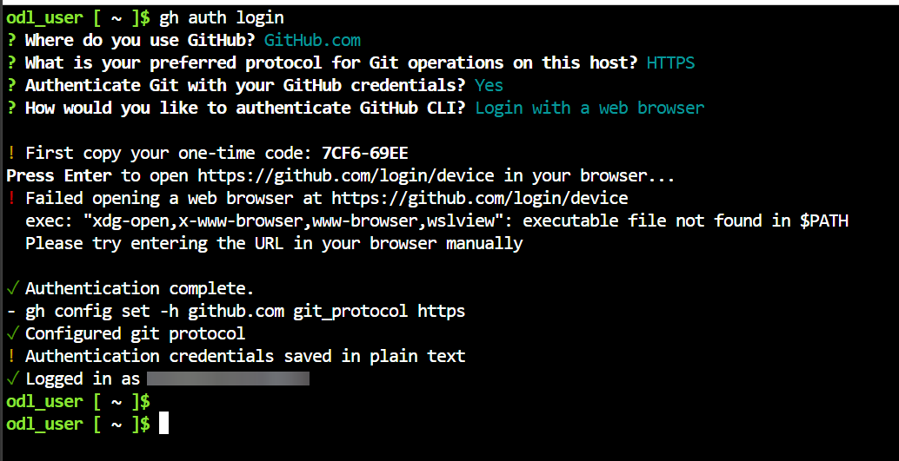

5.  After you have completed the GitHub sign-in process, run the provided command to fork the **contoso-air** repository to your GitHub account, and then verify that the fork is created successfully under your GitHub repositories.

    +++gh repo fork Azure-Samples/contoso-air --clone --default-branch-only+++

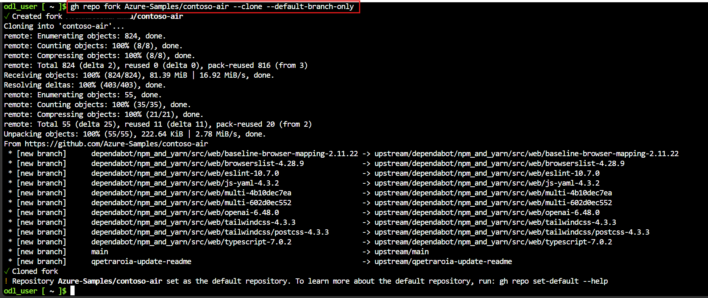

6.  Change into the **contoso-air** directory.

    +++cd contoso-air+++

7.  Set the default repository to your forked repository.

    +++gh repo set-default+++

8.  When prompted, select your fork of the repository and select **Enter**. Do not select the original **Azure-Samples/contoso-air** repository.

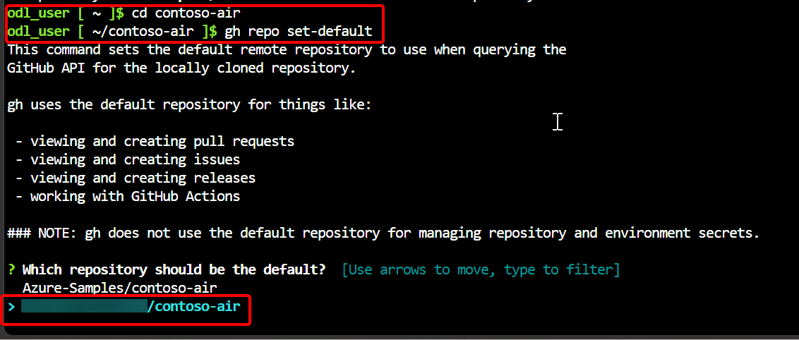

9.  Configure your Git identity by running the following commands, replacing the placeholder values with your GitHub username and email address:

    +++git config user.name  "<your GitHub user>"+++

    +++git config user.email "<your email>"+++

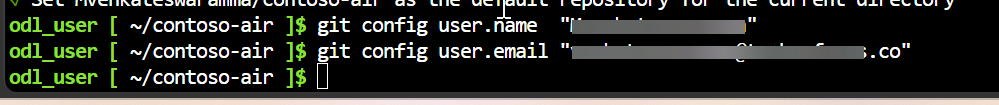

10. Save your **GitHub username** and **email** address, as they will be required in later tasks for repository configuration, authentication, and deployment operations.

### Task 6: Record your GitHub IDs

1.  GitHub identifies your repository by numeric IDs. Run the following command, replacing **\<your-user\>** with your GitHub username. In the command output, note and save the **Owner ID** and **Repo ID** values, as they are required later in this lab.

    +++gh api repos/<your-user>/contoso-air --jq '"Owner ID: \(.owner.id)   Repo ID: \(.id)"'+++

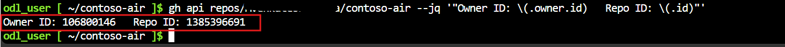

## Exercise 2: Create the cluster and pipeline

**Note:** In this lab environment, your account has permissions at the resource-group level. The Azure portal **Automated Deployments** wizard requires the Owner or User Access Administrator role at subscription level to connect the container registry to the cluster, so it cannot complete here. Instead, you create the cluster and the GitHub Actions deployment pipeline with Azure CLI and GitHub CLI. The result is the same: every push to the **main** branch of your fork builds the container image in Azure Container Registry and deploys it to the **dev** namespace of **myakscluster**.

### Task 1: Create the AKS Automatic cluster

In this task, you create the AKS Automatic cluster **myakscluster** and connect it to the Azure Container Registry in your resource group. AKS Automatic capacity varies by region, so the command tries several regions and uses the first one that has capacity.

1.  In Azure Cloud Shell, run the following commands to load your variables and get the names of the resources you deployed in Exercise 1.

    +++source ~/aks-lab.env+++

    +++export ACR_NAME=$(az acr list -g $RG_NAME --query "[0].name" -o tsv)+++

    +++export LAW_ID=$(az monitor log-analytics workspace list -g $RG_NAME --query "[0].id" -o tsv)+++

    +++export AMW_ID=$(az monitor account list -g $RG_NAME --query "[0].id" -o tsv)+++

2.  Run the following command to verify the values. Each line must show a value.

    +++echo "RG_NAME=$RG_NAME ACR_NAME=$ACR_NAME"; echo "LAW_ID=$LAW_ID"; echo "AMW_ID=$AMW_ID"+++

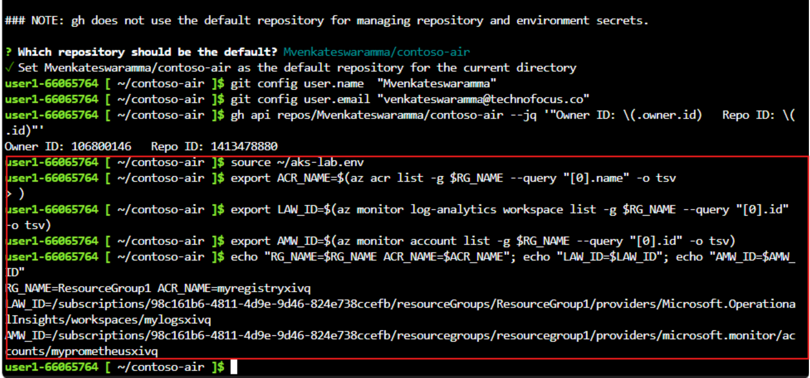

3.  Run the following command to remove the **aks-preview** Azure CLI extension. With the extension installed, AKS Automatic uses a VM size that the lab subscription does not allow. The cluster command in the next step sets an allowed VM size instead.

    +++az extension remove --name aks-preview 2>/dev/null; az extension list --query "[].name" -o tsv+++

4.  Run the following command to create the cluster. The command tries your resource group's region first, and then East US 2, West US 3, East US and Sweden Central. If a region has no capacity, the command removes the failed attempt and tries the next region. Creating the cluster takes 10–15 minutes.

```
for r in $LOCATION eastus2 westus3 eastus swedencentral; do echo ">>> Trying $r"; if az aks create --resource-group $RG_NAME --name myakscluster --location $r --sku automatic --node-vm-size Standard_D4ds_v5 --attach-acr $ACR_NAME --workspace-resource-id $LAW_ID --enable-azure-monitor-metrics --azure-monitor-workspace-resource-id $AMW_ID; then echo ">>> SUCCESS in $r"; break; else az aks delete --resource-group $RG_NAME --name myakscluster --yes 2>/dev/null; fi; done
```
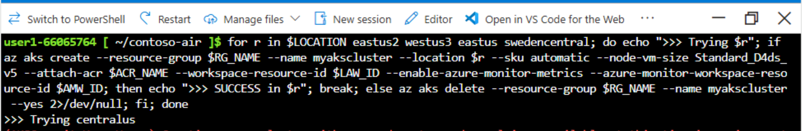

**Note:** Errors such as **AKSCapacityHeavyUsage** or **SkuNotAvailable** for a region are expected. The command continues with the next region. Wait until you see **\>\>\> SUCCESS in \<region\>**. Do not press any keys while the command runs.

**Note:** If you see **The VM size of ... is not allowed in your subscription**, the error lists the allowed VM sizes. Replace Standard_D4ds_v5 in the command with an allowed 4-vCPU size, such as Standard_D4s_v5 or Standard_D4as_v5, and run the command again. Do not add --enable-addons monitoring: AKS Automatic enables monitoring automatically, and adding it causes a **Duplicate addon** error.

5.  Run the following command to verify the cluster. **myakscluster** must show **Succeeded**. Note the **Location** of your cluster.

    +++az aks list --resource-group $RG_NAME -o table+++

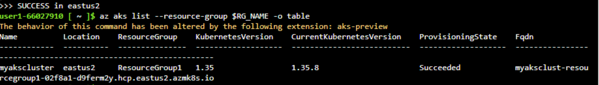

6.  AKS Automatic uses Azure RBAC to control access to the Kubernetes API. Run the following commands to give your account administrator access to the cluster.

    +++export AKS_ID=$(az aks show -g $RG_NAME -n myakscluster --query id -o tsv)+++

    +++az role assignment create --role "Azure Kubernetes Service RBAC Cluster Admin" --assignee-object-id $USER_ID --assignee-principal-type User --scope $AKS_ID+++

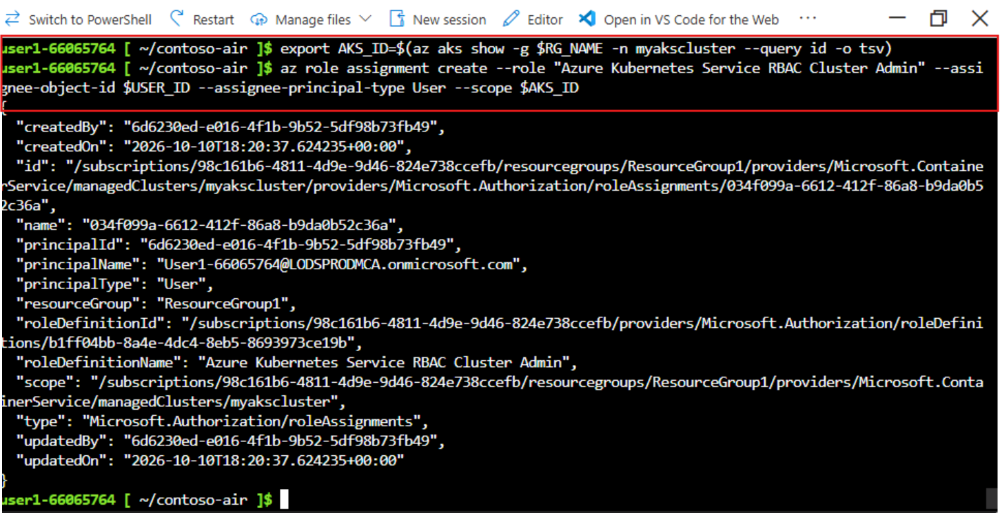

7.  Wait 1–2 minutes, and then run the following commands to connect kubectl to the cluster.

    +++az aks get-credentials --resource-group $RG_NAME --name myakscluster --overwrite-existing+++

    +++kubelogin convert-kubeconfig -l azurecli+++

    +++kubectl get nodes+++

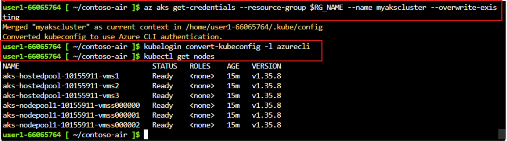

**Note:** A list of nodes or **No resources found** are both expected. You can ignore the warning about the version difference between client and server. If you see **You must be logged in to the server**, run the two previous commands again. If **kubelogin** is not found, run **az aks install-cli** and try again.

8.  Run the following command to create the **dev** namespace for the application.

    +++kubectl create namespace dev+++

9.  (Optional) Run the following command to confirm that the cluster can pull images from your registry. The output must include a row with the **AcrPull** role.

```
az role assignment list --assignee $(az aks show -g $RG_NAME -n myakscluster --query identityProfile.kubeletidentity.objectId -o tsv) --scope $(az acr show -n $ACR_NAME --query id -o tsv) -o table
```

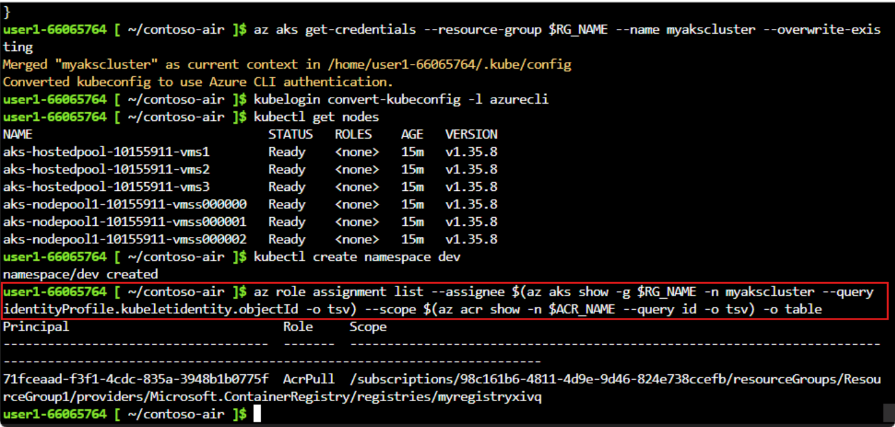

**Note:** Do not use **az aks check-acr** on AKS Automatic. Its test pod uses host networking, which the AKS Automatic baseline security policy blocks, so the check always fails even when the registry is connected.

### Task 2: Create the identity for GitHub Actions

GitHub Actions signs in to Azure with a user-assigned managed identity and a federated credential, so no passwords or secrets are stored in GitHub. In this task, you create the identity, allow the **main** branch of your fork to use it, and grant it the permissions the pipeline needs.

1.  Run the following commands to load your variables and look up your GitHub user name, owner ID and repository ID.

    +++cd ~/contoso-air && source ~/aks-lab.env+++

    +++export GH_USER=$(gh api user --jq .login) && export OWNER_ID=$(gh api repos/$GH_USER/contoso-air --jq .owner.id) && export REPO_ID=$(gh api repos/$GH_USER/contoso-air --jq .id)+++

    +++echo "GH_USER=$GH_USER OWNER_ID=$OWNER_ID REPO_ID=$REPO_ID"+++

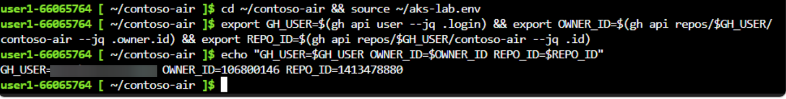

**Note:** The values must match the GitHub user name, Owner ID and Repo ID that you recorded in Exercise 1, Task 5 and Task 6.

2.  Run the following command to create the managed identity **workflowapp-identity**.

    +++az identity create --resource-group $RG_NAME --name workflowapp-identity --location $LOCATION+++

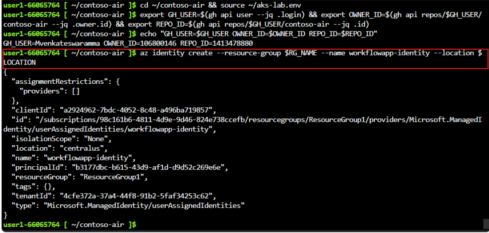

3.  Run the following command to save the identity's client ID and principal ID.

```
export GH_USER=$(gh api user --jq .login) && export OWNER_ID=$(gh api repos/$GH_USER/contoso-air --jq .owner.id) && export REPO_ID=$(gh api repos/$GH_USER/contoso-air --jq .id)
```
```
echo "GH_USER=$GH_USER OWNER_ID=$OWNER_ID REPO_ID=$REPO_ID"
```

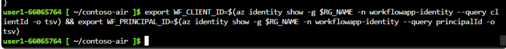

4.  Run the following commands to add federated credentials for the **main** branch of your fork. The second credential uses GitHub's immutable owner and repository IDs.

    +++az identity federated-credential create --resource-group $RG_NAME --identity-name workflowapp-identity --name github-main --issuer https://token.actions.githubusercontent.com --subject "repo:$GH_USER/contoso-air:ref:refs/heads/main" --audiences api://AzureADTokenExchange+++

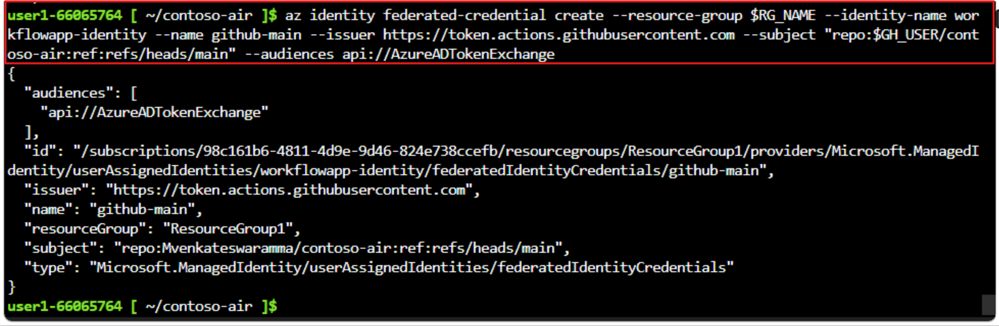

+++az identity federated-credential create --resource-group $RG_NAME --identity-name workflowapp-identity --name github-main-immutable --issuer https://token.actions.githubusercontent.com --subject "repo:$GH_USER@$OWNER_ID/contoso-air@$REPO_ID:ref:refs/heads/main" --audiences api://AzureADTokenExchange+++

| **Field**                       | **Value**                                                            |
|-----------------------------------------------------------|------------------------------------------------------------------------------------------------|
| Issuer                          | https://token.actions.githubusercontent.com                          |
| Subject (github-main)           | repo:\<your GitHub user\>/contoso-air:ref:refs/heads/main            |
| Subject (github-main-immutable) | repo:\<user\>@\<ownerId\>/contoso-air@\<repoId\>:ref:refs/heads/main |
| Audience                        | api://AzureADTokenExchange                                           |

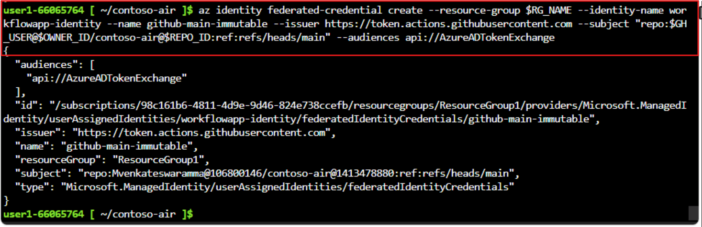

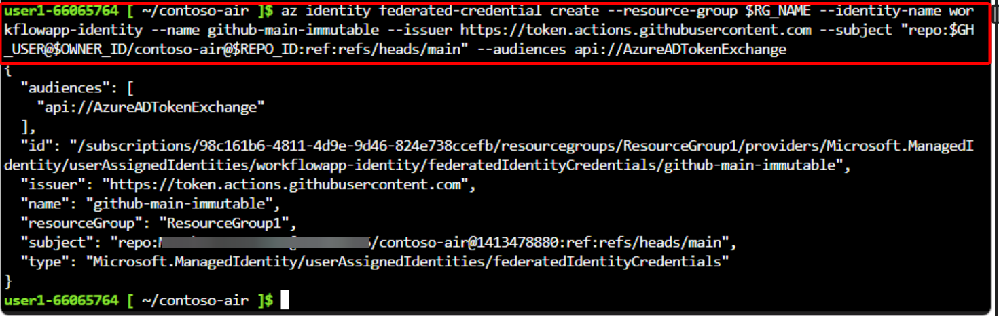

5.  Run the following command to verify that both credentials exist.

    +++az identity federated-credential list -g $RG_NAME --identity-name workflowapp-identity --query "[].{name:name, subject:subject}" -o table+++

6.  Wait 30 seconds, and then run the following commands to grant the identity the permissions the pipeline needs.

| **Role (scope)**                                      | **Why the pipeline needs it**           |
|---------------------------------------------------------------------------------|-------------------------------------------------------------------|
| Reader (resource group)                               | Sign in to the subscription             |
| Contributor (container registry)                      | Build and push the image with ACR Tasks |
| Azure Kubernetes Service Cluster User Role (cluster)  | Download the cluster credentials        |
| Azure Kubernetes Service RBAC Cluster Admin (cluster) | Apply the Kubernetes manifests          |

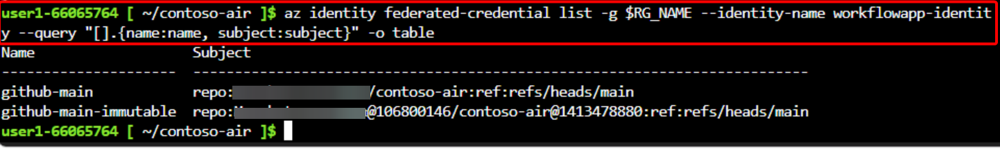

```
cd ~/contoso-air && source ~/aks-lab.env && export WF_PRINCIPAL_ID=$(az identity show -g $RG_NAME -n workflowapp-identity --query principalId -o tsv) && echo "RG_NAME=$RG_NAME WF_PRINCIPAL_ID=$WF_PRINCIPAL_ID"
```

```
az role assignment create --assignee-object-id $WF_PRINCIPAL_ID --assignee-principal-type ServicePrincipal --role Reader --scope $(az group show -n $RG_NAME --query id -o tsv)
```

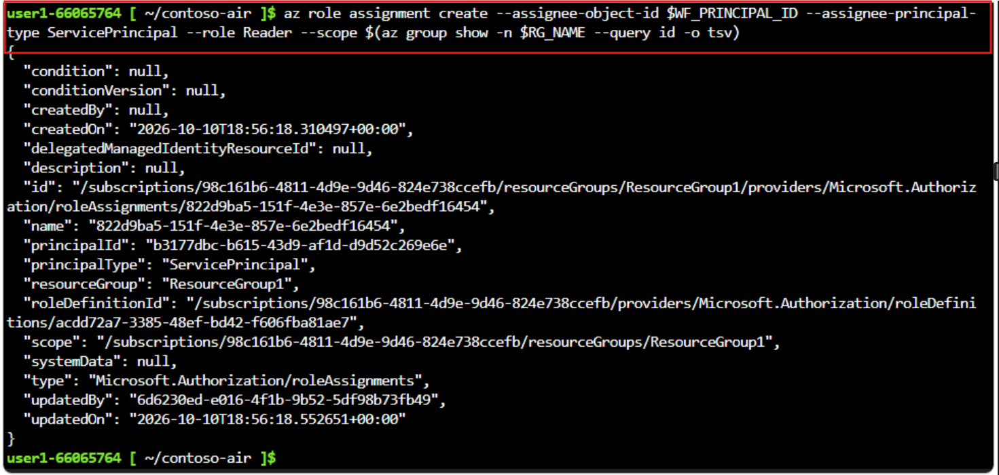

```
az role assignment create --assignee-object-id $WF_PRINCIPAL_ID --assignee-principal-type ServicePrincipal --role Contributor --scope $(az acr list -g $RG_NAME --query "[0].id" -o tsv)
```

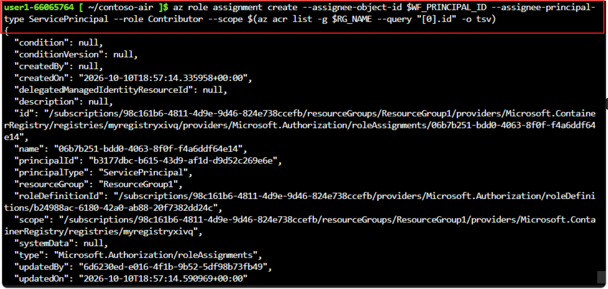

```
az role assignment create --assignee-object-id $WF_PRINCIPAL_ID --assignee-principal-type ServicePrincipal --role "Azure Kubernetes Service Cluster User Role" --scope $(az aks show -g $RG_NAME -n myakscluster --query id -o tsv)
```

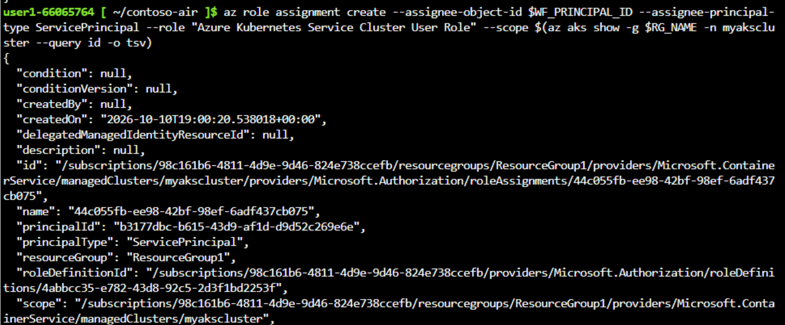

```
az role assignment create --assignee-object-id $WF_PRINCIPAL_ID --assignee-principal-type ServicePrincipal --role "Azure Kubernetes Service RBAC Cluster Admin" --scope $(az aks show -g $RG_NAME -n myakscluster --query id -o tsv)
```

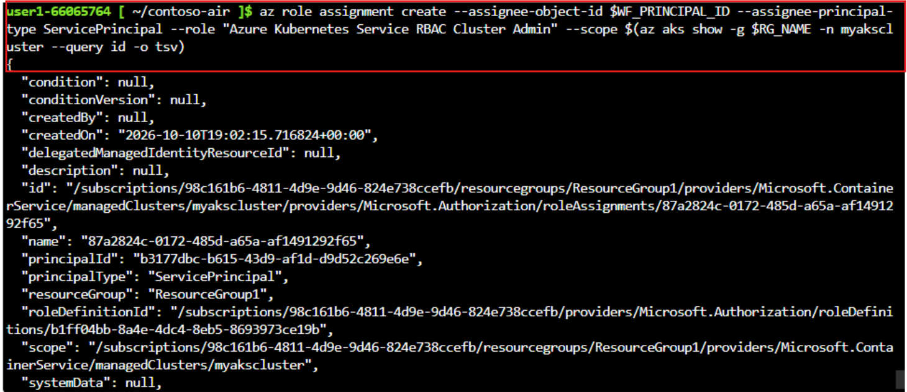

### Task 3: Connect your GitHub fork to Azure

1.  Run the following command to allow the GitHub CLI to push workflow files. Copy the one-time code, press Enter, open https://github.com/login/device, enter the code and select **Authorize**.

    +++gh auth refresh -h github.com -s workflow+++

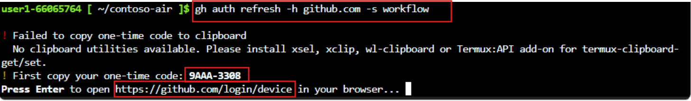

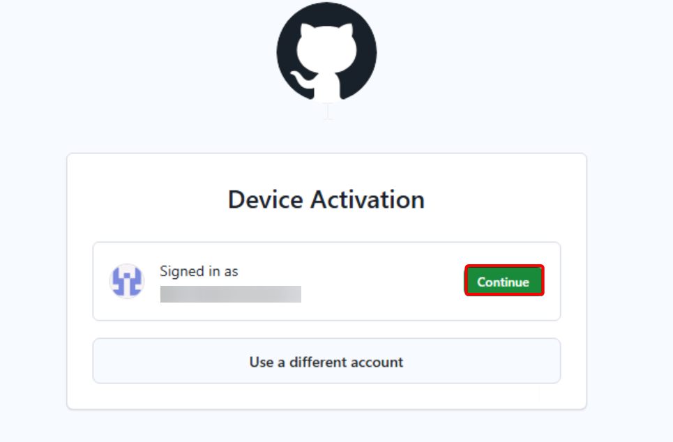

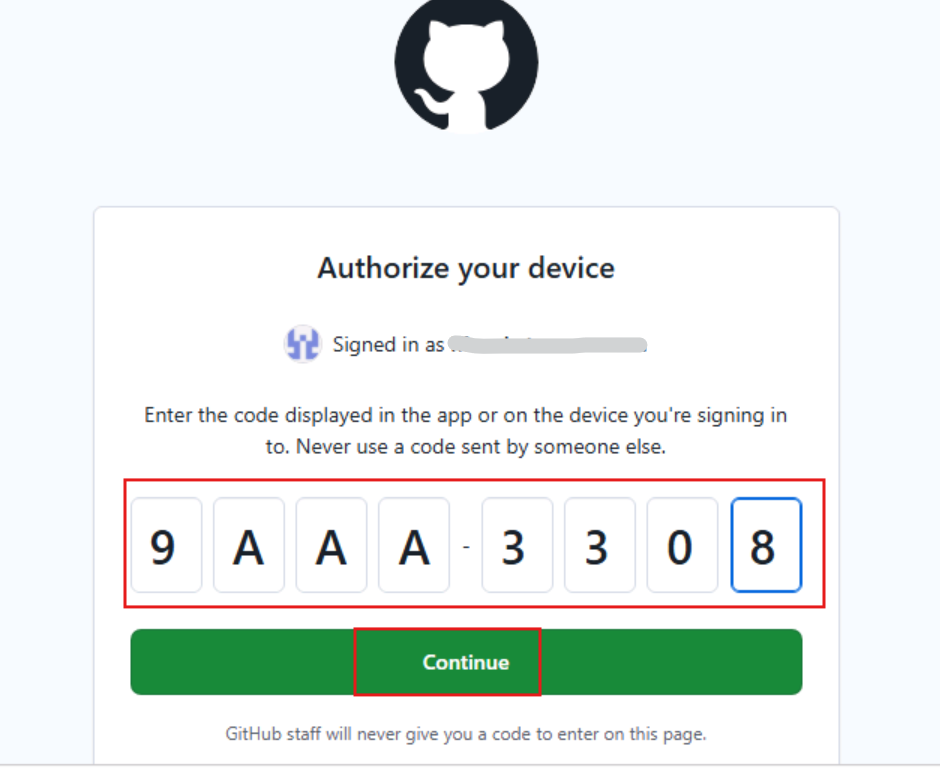


2.  GitHub Actions is turned off by default in forked repositories. Run the following command to turn it on for your fork.

    +++gh api -X PUT repos/$(gh api user --jq .login)/contoso-air/actions/permissions -F enabled=true -f allowed_actions=all+++

3.  Run the following command to save the full name of your fork (for example, **\<your GitHub user\>/contoso-air**) in a variable. The output must show your fork, not Azure-Samples/contoso-air.

    +++cd ~/contoso-air && source ~/aks-lab.env && export GH_REPO_FULL="$(gh api user --jq .login)/contoso-air" && echo $GH_REPO_FULL+++


**Note:** In a forked repository, **gh secret** and **gh variable** do not use the default repository that you set with gh repo set-default. Without the **-R \$GH_REPO_FULL** option, the GitHub CLI asks you to select a repository, or tries to save to **Azure-Samples/contoso-air** and fails with **HTTP 403: You must have repository write permissions**. The commands below always use -R so the values are saved to your fork.

4.  Run the following command to save the Azure sign-in details as repository secrets in your fork.

    +++gh secret set AZURE_CLIENT_ID -R $GH_REPO_FULL --body "$(az identity show -g $RG_NAME -n workflowapp-identity --query clientId -o tsv)" && gh secret set AZURE_TENANT_ID -R $GH_REPO_FULL --body "$(az account show --query tenantId -o tsv)" && gh secret set AZURE_SUBSCRIPTION_ID -R $GH_REPO_FULL --body "$(az account show --query id -o tsv)"+++


5.  Run the following command to save your resource names as repository variables in your fork. The workflow reads these values, so it works with the resource names in your lab.

    +++gh variable set RESOURCE_GROUP -R $GH_REPO_FULL --body "$RG_NAME" && gh variable set ACR_NAME -R $GH_REPO_FULL --body "$(az acr list -g $RG_NAME --query "[0].name" -o tsv)" && gh variable set CLUSTER_NAME -R $GH_REPO_FULL --body "myakscluster"+++


6.  Run the following command to verify. You should see three secrets (**AZURE_CLIENT_ID**, **AZURE_SUBSCRIPTION_ID**, **AZURE_TENANT_ID**) and three variables (**ACR_NAME**, **CLUSTER_NAME**, **RESOURCE_GROUP**) with your values.

    +++gh secret list -R $GH_REPO_FULL && gh variable list -R $GH_REPO_FULL+++

### Task 4: Add the deployment workflow and Kubernetes manifests

In this task, you add a GitHub Actions workflow and the Kubernetes manifests to a new branch, and then open a pull request. The workflow has two jobs: **buildImage** builds the container image with ACR Tasks and pushes it to your registry, and **deploy** applies the manifests to the **dev** namespace of **myakscluster**.

1.  Run the following command to create a branch and the folders for the files.

    +++cd ~/contoso-air && git checkout main && git pull && git checkout -b aks-deploy && mkdir -p manifests .github/workflows+++


2.  Create the Deployment manifest. Copy the whole block below, including the last line **EOF**, paste it into Cloud Shell and press Enter.

```bash
cat > manifests/deployment.yaml <<'EOF'
apiVersion: apps/v1
kind: Deployment
metadata:
  name: contoso-air
  labels:
    app: contoso-air
spec:
  replicas: 1
  selector:
    matchLabels:
      app: contoso-air
  template:
    metadata:
      labels:
        app: contoso-air
    spec:
      containers:
      - name: contoso-air
        image: ACR_NAME_PLACEHOLDER.azurecr.io/contoso-air:IMAGE_TAG
        ports:
        - containerPort: 3000
        envFrom:
        - configMapRef:
            name: contoso-air-config
        resources:
          requests:
            cpu: 250m
            memory: 256Mi
          limits:
            cpu: 500m
            memory: 512Mi
        readinessProbe:
          tcpSocket:
            port: 3000
        livenessProbe:
          tcpSocket:
            port: 3000
EOF
```


3.  Run the following commands to create the Service and ConfigMap manifests.

    +++printf 'apiVersion: v1\nkind: Service\nmetadata:\n  name: contoso-air\nspec:\n  type: LoadBalancer\n  selector:\n    app: contoso-air\n  ports:\n  - port: 80\n    targetPort: 3000\n' > manifests/service.yaml+++

    +++printf 'apiVersion: v1\nkind: ConfigMap\nmetadata:\n  name: contoso-air-config\n' > manifests/configmap.yaml+++


4.  Create the GitHub Actions workflow. Copy the whole block below, including the last line **EOF**, paste it into Cloud Shell and press Enter.

```bash
cat > .github/workflows/aks-deploy.yaml <<'EOF'
name: Automated Deployments - contoso-air
on:
  push:
    branches: [main]
  workflow_dispatch:
permissions:
  id-token: write
  contents: read
env:
  RESOURCE_GROUP: ${{ vars.RESOURCE_GROUP }}
  ACR_NAME: ${{ vars.ACR_NAME }}
  CLUSTER_NAME: ${{ vars.CLUSTER_NAME }}
  NAMESPACE: dev
jobs:
  buildImage:
    runs-on: ubuntu-latest
    steps:
      - uses: actions/checkout@v4
      - uses: azure/login@v2
        with:
          client-id: ${{ secrets.AZURE_CLIENT_ID }}
          tenant-id: ${{ secrets.AZURE_TENANT_ID }}
          subscription-id: ${{ secrets.AZURE_SUBSCRIPTION_ID }}
      - name: Build and push image to ACR
        run: az acr build --registry $ACR_NAME --image contoso-air:${{ github.sha }} ./src/web
  deploy:
    needs: buildImage
    runs-on: ubuntu-latest
    steps:
      - uses: actions/checkout@v4
      - uses: azure/login@v2
        with:
          client-id: ${{ secrets.AZURE_CLIENT_ID }}
          tenant-id: ${{ secrets.AZURE_TENANT_ID }}
          subscription-id: ${{ secrets.AZURE_SUBSCRIPTION_ID }}
      - name: Install kubelogin
        run: |
          curl -sSL -o kubelogin.zip https://github.com/Azure/kubelogin/releases/latest/download/kubelogin-linux-amd64.zip
          unzip -q kubelogin.zip -d kubelogin
          sudo mv kubelogin/bin/linux_amd64/kubelogin /usr/local/bin/
          kubelogin --version
      - name: Connect to AKS
        run: |
          az aks get-credentials -g $RESOURCE_GROUP -n $CLUSTER_NAME --overwrite-existing
          kubelogin convert-kubeconfig -l azurecli
      - name: Deploy to AKS
        run: |
          sed -i "s|ACR_NAME_PLACEHOLDER|$ACR_NAME|; s|IMAGE_TAG|${{ github.sha }}|" manifests/deployment.yaml
          kubectl get configmap contoso-air-config -n $NAMESPACE >/dev/null 2>&1 || kubectl apply -n $NAMESPACE -f manifests/configmap.yaml
          kubectl apply -n $NAMESPACE -f manifests/deployment.yaml -f manifests/service.yaml
          kubectl rollout status deployment/contoso-air -n $NAMESPACE --timeout=600s
EOF
```


5.  Run the following command to verify that all four files exist. The output must list **configmap.yaml**, **deployment.yaml**, **service.yaml** and **aks-deploy.yaml**. If a file is missing, repeat the step that creates it.

    +++ls manifests .github/workflows+++


6.  Run the following command to commit the files and push the branch to your fork.

    +++git add manifests .github/workflows/aks-deploy.yaml && git commit -m "Add AKS automated deployment workflow" && git push -u origin aks-deploy+++


**Note:** If the push is rejected with **refusing to allow an OAuth App to create or update workflow**, repeat Task 3, step 1, and push again.

7.  Run the following command to create the pull request. The command prints the pull request URL.

    +++gh pr create --base main --head aks-deploy --title "Automated Deployments: contoso-air to AKS" --body "Adds the GitHub Actions workflow and Kubernetes manifests for myakscluster."+++


### Task 5: Review, merge, and deploy application changes

1.  Open the pull request URL in your browser, or open the **Pull requests** tab of your fork on GitHub and select the **Automated Deployments: contoso-air to AKS** pull request.


2.  Select the **Files changed** tab and review the changes:

- **manifests/deployment.yaml**: the container image, CPU and memory requests and limits (required by AKS Automatic deployment safeguards), readiness and liveness probes, and the **contoso-air-config** ConfigMap that you configure in Exercise 3.

- **.github/workflows/aks-deploy.yaml**: the **buildImage** and **deploy** jobs.

**Note:** The manifest does not add Linux capabilities such as SYS_PTRACE. The AKS Automatic baseline pod security policy blocks them.


3.  Select the **Conversation** tab, select **Merge pull request**, and then select **Confirm merge**.

4.  Merging into **main** starts the workflow. Select the **Actions** tab in your fork, and then select the **Automated Deployments - contoso-air** run to view the logs. You can also follow the run from Cloud Shell:

    +++cd ~/contoso-air && git checkout main && git pull && gh run watch+++


5.  After 5–10 minutes, the **buildImage** and **deploy** jobs show green check marks. The application is now deployed to your AKS cluster.


**Note:** You can ignore the warnings about Node.js 20 deprecation and the ubuntu-latest runner migration. They do not affect the workflow.

**Troubleshooting the workflow**

To see the error from a failed run, run the following command in **~/contoso-air**:

+++gh run view --log-failed | tail -40+++

| **Error**                                                | **Fix**                                                                                                                                                                     |
|------------------------------------------------------------------------------------|-------------------------------------------------------------------------------------------------------------------------------------------------------------------------------------------------------|
| AADSTS70021: No matching federated identity record found | Repeat Task 2, step 4, and then rerun the failed jobs with **gh run rerun --failed**.                                                                                       |
| AuthorizationFailed or Forbidden                         | Role assignments can take up to 5 minutes to apply. Wait, and then run **gh run rerun --failed**.                                                                           |
| error: the path "manifests/\<file\>.yaml" does not exist | The file was not committed. Create it again (Task 4, steps 2–3), and then run **git add manifests && git commit -m "Add missing manifest" && git push** on the main branch. |
| namespaces "dev" not found                               | Run **kubectl create namespace dev**, and then run **gh run rerun --failed**.                                                                                               |

### Task 6: Verify the application deployment in the dev namespace

1.  In Cloud Shell, run the following command to check the deployment. The **contoso-air** pod must be **Running 1/1**, the **contoso-air** service must show an **EXTERNAL-IP**, and the **contoso-air-config** ConfigMap must be listed.

    +++kubectl get pods,svc,configmap -n dev+++


2.  In the **Azure portal**, navigate to **myakscluster**.


3.  Select **Kubernetes resources**, and then select **Services and ingresses** to view the services exposed by the cluster and verify that the application is running in the **dev** namespace.


4.  In the **Services and ingresses** page, locate the **contoso-air** service in the dev namespace, and then select the external IP address (**\<EXTERNAL-IP\>**) to open the deployed application and verify that it is running successfully.


5.  Test the application's chat functionality by selecting the **Ask the AI travel assistant** button.


6.  Try to interact with the AI assistant. You'll find that the chat provider is not detected.


## Exercise 3: Integrating apps with Azure services

AKS Service Connector streamlines connecting applications to Azure resources like Azure OpenAI by automating the configuration of Workload Identity. It assigns identities to pods, enabling them to authenticate with Microsoft Entra ID and access Azure services securely without passwords.

### Task 1: Application configuration

A ConfigMap is a Kubernetes resource that stores non-confidential configuration data as key-value pairs. Applications running in pods can read these values as environment variables, making it easy to change application behavior without rebuilding the container image.

1.  In the **Azure portal**, navigate to **myakscluster**, select **Configuration under Kubernetes resources**, choose the dev namespace from the **Filter** *by namespace* list, and then verify that the application configuration resources are available in the **dev** namespace.


2.  Select **contoso-air-config** config map


3.  Select the **YAML** tab. In the YAML editor, add the following configuration to the end of the file, and then select **Review + save**.

```yaml
data:
  AZURE_OPENAI_API_VERSION: 2024-12-01-preview
  AZURE_OPENAI_DEPLOYMENT: gpt-5.4-mini
  CHAT_PROVIDER: azure
  LOG_CHAT: 'true'
```


4.  Review the changes in the **contoso-air-config** configuration map, verify that the Azure OpenAI settings are correct, select **Confirm manifest changes**, and then select **Save** to apply the updated configuration to the application.


**Info:** This configmap was created by your GitHub Actions deployment workflow in Exercise 2. The new configuration settings you added will instruct the application to use Azure OpenAI as the chat provider and specify the deployment name of the model to use and the contoso-air application is already configured to read these settings and inject them into the application environment.

### Task 2: Service Connector setup

1.  In the menu, select **Service Connector** under **Settings** then select the **+ Create** button.


2.  In the **Basics** tab, enter the following details:

- **Kubernetes namespace**: Enter +++dev+++

- **Service type**: Select **OpenAI Service**

- **OpenAI**: Select the Azure OpenAI account you created earlier

- Select **Next: Authentication**.


3.  In the **Authentication** tab, select the **Workload Identity** option and expand the **Advanced** section.


4.  By default, the **Cognitive Services OpenAI Contributor** role is assigned, granting the workload identity permissions to authenticate and interact with your LLM. You'll also notice there's additional configuration information that Service Connector will set as environment variables in the application. These variables will be saved to a Kubernetes Secret which will then be used to configure the connection to the Azure OpenAI account.

5.  Select **Next: Networking** then select **Next: Review + create** and finally select **Create**.


### Task 3: Configure the application for Workload Identity

Once you've successfully set up the Service Connector for your Azure OpenAI account, it's time to configure your application to use these connection details.

1.  In the **Service Connector** page, select the **checkbox** next to the **OpenAI connection** and select the **Yaml snippet** button.


2.  In the **YAML snippet** window, select **Kubernetes Workload** for **Resource type**, then select **contoso-air** for **Kubernetes Workload**.


3.  You will see the YAML manifest for the **contoso-air** application with the highlighted edits required to connect to Azure OpenAI via Workload Identity.

4.  Scroll through the YAML manifest to view all the changes highlighted in yellow, then select **Apply** to apply the changes to the application. This will redeploy the contoso-air application with the new connection details.


**Note:** This will apply changes directly to the application deployment but ideally you would want to commit these changes to your repository so that they are versioned and can be tracked and automatically deployed using the GitHub Actions workflow that you set up in Exercise 2.

5.  Wait a minute or two for the new pod to be rolled out then navigate back to the application and attempt to interact with the AI assistant. Now, you should be able to chat with an AI assistant without any errors!


## Exercise 4: Observing your cluster and apps

Monitoring and observability are key components of running applications in production. AKS Automatic provides many monitoring and observability features out-of-the-box. Let's take a closer look at how you can monitor and observe your application and cluster.

At the start of the workshop, you integrated the AKS Automatic cluster with Azure Log Analytics Workspace for logging and Azure Monitor Managed Workspace for metrics collection. AKS also provides built-in Grafana dashboards for data visualization.

Now, you can also enable the Azure Monitor Application Insights for AKS feature to automatically instrument your applications with Azure Application Insights.

### Task 1: App monitoring

Azure Monitor Application Insights is an Application Performance Management (APM) solution for real-time monitoring of your applications. It uses OpenTelemetry (OTel) to collect telemetry data and stream it to Azure Monitor, helping you evaluate performance, pinpoint bottlenecks, and gain actionable insights. With AKS, the AutoInstrumentation feature collects telemetry without requiring any code changes.

1.  To enable the app monitoring feature on your AKS cluster navigate to the **Monitor** blade of your AKS cluster in the Azure portal then select **Monitor Settings**.


2.  Scroll down to the **Application monitoring (preview)** section and select the **Enable** checkboxes for both auto-instrumentation and OpenTelemetry data collection, then select the **Next** button.


3.  Review the changes and select the **Enable** button to enable the feature.


4.  The onboarding process takes 5–6 minutes to complete as the necessary components are being set up in your cluster. Wait for the process to complete before moving on to the next steps.


With this feature enabled, you can now deploy a new Instrumentation custom resource to your AKS cluster to automatically instrument your applications without any modifications to the code.

5.  Navigate to the **Workloads** section under **Kubernetes resources** in the menu. Filter by the **dev** namespace and select the **contoso-air** deployment to view the deployment details.


6.  Select the **Application Monitoring (Preview)** tab to configure AutoInstrumentation for the contoso-air application.


7.  In the **Configure Application Monitoring** pane, enter the following details:

- **Application Insights**: Select the Application Insights resource in your resource group

- **Application Language**: Select **NodeJS auto-instrumentation for all deployments**

- Check the **Perform rollout restart of all deployments in the namespace to deploy changes immediately** checkbox.

- Select **Configure** to apply the changes.


**Tip:** This is a simple example of how to instrument your application across an entire namespace. You can also instrument individual deployments by deploying custom resources into your Kubernetes cluster. See the [documentation](https://learn.microsoft.com/azure/azure-monitor/app/kubernetes-codeless#mixed-mode-onboarding) for more details.

Once the configuration is applied, the contoso-air deployment will be restarted to apply the instrumentation changes immediately.


8.  Verify that the application monitoring deployment has completed successfully, review the deployment status for all monitoring steps, and then select **Close** to exit the **Application Monitoring Progress** pane.


Now that the application is instrumented with Application Insights, navigate back to the contoso-air application in your web browser and chat with the AI assistant to generate some metrics. Once the metrics have been generated and collected by the OTel collector, you can view the application performance and usage metrics in the Azure portal.

9.  Navigate to the **Application Insights** resource in your resource group.


10. Select the **Application map** under **Investigate** in the menu to view a high-level overview of the application components, their dependencies, and number of calls.


**Note:** If the Azure OpenAI endpoint does not appear in the application map, return to the Contoso Air website and chat with the AI assistant a bit more to generate some data. Then, in the Application Map, select the **Refresh** button. The map will update in real time and should now display the application connected to the Azure OpenAI endpoint, along with the request latency to the model endpoint.


11. Select the **Live Metrics** tab to view the live metrics for the application. Here you can see incoming and outgoing requests, response times, and exceptions in real-time.


12. Finally, select the **Performance** tab to view the performance metrics for the application. Here you can see the average response time, request rate, and failure rate for the application.


Feel free to explore the other features of Application Insights and see how you can use it to monitor and observe your applications.

### Task 2: Cluster monitoring

AKS Automatic simplifies monitoring your cluster using [Container Insights](https://learn.microsoft.com/azure/azure-monitor/containers/container-insights-overview). It gathers and analyzes logs, metrics, and events from your cluster and applications, providing valuable insights into their performance and health.

1.  In the Azure portal, navigate to **myakscluster**, select **Monitor** (**Insights**), open the More options **(...)** menu, and then select **Recommended alerts** to review and configure the recommended monitoring alerts for the AKS cluster.


The AKS Automatic cluster was also pre-configured with basic CPU utilization and memory utilization alerts. You can also create additional alerts based on the metrics collected by the Prometheus workspace.

2.  Expand the **Prometheus community alert rules (Preview)** section to see the list of Prometheus alert rules that are available. You can enable any of these alerts by selecting the toggle switch.

3.  Select **Save** to enable the alerts.


### Task 3: Workbooks and logs

With Container Insights enabled, you can query logs using Kusto Query Language (KQL) and create custom or pre-configured workbooks for data visualization.

1.  In the **Monitoring** section of the AKS cluster menu, select **Workbooks** to access pre-configured options. The **Cluster Optimization** workbook is particularly useful for identifying anomalies, detecting probe failures, and optimizing container resource requests and limits. Explore this and other available workbooks to monitor your cluster effectively.


**Note:** The workbook visuals will include a query button that you can select to view the KQL query that powers the visual. This is a great way to learn how to write your own queries.

2.  Select **Logs** from the **Monitoring** section in the AKS cluster menu. This section provides access to the logs gathered by the Azure Monitor agent operating on the cluster nodes.


**Note:** If you are presented with a **Welcome to Log Analytics** pop-up, close it to access the query editor.

3.  Close the **Queries hub** pop-up to get to the query editor, then change the query editor from **Simple mode** to **KQL mode** by using the drop-down menu in the top-right corner.


You should see some log messages in the table below. Expand some of the logs to view the message details that were generated by the application.

**Note:** Some of the queries might not have enough data to return results.

### Task 4: Dashboards with Grafana

The Azure portal provides a great way to view metrics and logs, but if you prefer to visualize the data using Grafana, or execute complex queries using PromQL, you can use the **Dashboards with Grafana** feature built into AKS.

**Info: Dashboards with Grafana** is a free Grafana experience integrated directly into the AKS portal. It does not require a separate Azure Managed Grafana resource. This built-in feature gives you access to pre-configured dashboards and PromQL queries for your cluster metrics without any additional cost or setup.

1.  In the AKS cluster's menu, select **Dashboards with Grafana** under the **Monitoring** section. You'll see a list of all the pre-configured Grafana dashboards available for your cluster.


2.  Sign in to the Grafana instance, then in the Grafana home page, select the **Dashboards** link in the menu. Here you'll see a list of pre-configured dashboards that you can use to visualize the metrics collected by the Prometheus workspace.

3.  In the **Dashboards** list, expand the **Azure Managed Prometheus** folder and explore the dashboards available. Each dashboard provides a different view of the metrics collected by the Prometheus workspace with controls to allow you to filter the data.

4.  Select a **Kubernetes / Compute Resources / Workload** dashboard.


5.  Filter the **namespace** to **dev** the **type** to **deployment**, and the **workload** to **contoso-air**. This will show you the metrics for the **contoso-air** deployment.


### Task 5: Querying metrics with PromQL

1.  Select **Dashboards** to navigate back to the dashboards list and select the **Explore** tab at the top of the pane.


2.  In the Dashboards with **Grafana** page, select the **Azure Monitor** data source dropdown, choose the **myprometheus\<xxx\>** Prometheus data source, and then use it to explore and visualize monitoring metrics for the AKS cluster.


3.  The query editor supports a graphical query builder and a text-based query editor. The graphical query builder is a great way to get started with PromQL. You can select the metric you want to query, the aggregation function, and any filters you want to apply.


There is a lot you can do with Grafana and PromQL, so take some time to explore the features and visualize the metrics collected by the Prometheus workspace.


## Exercise 5: Scaling your cluster and apps

Now that you have learned how to deploy applications to AKS Automatic and monitor your cluster and applications, let's explore how to scale your cluster and applications to handle the demands of your workloads effectively.

Right now, the application is running a single pod. When the web app is under heavy load, it may not be able to handle the requests. To automatically scale your deployments, use Kubernetes Event-driven Autoscaling (KEDA). KEDA scales your application workloads based on utilization metrics, number of events in a queue, or a custom schedule using CRON expressions.

But simply implementing KEDA is not enough. KEDA can try to deploy more pods, but if the cluster is out of resources, the pods will not be scheduled and remain in pending status.

With AKS Automatic, Node Autoprovisioning (NAP) is enabled and replaces the traditional cluster autoscaler. NAP detects pods pending scheduling and automatically scales the node pool to meet demand.

For the Kubernetes scheduler to efficiently place pods on nodes, it's best practice to include resource requests and limits in your pod configuration. Resource requests tell Kubernetes the minimum CPU and memory a container needs, while limits set the maximum it can use. These values help the scheduler find nodes with enough capacity.

The deployment manifest that you added to your repository in Exercise 2 includes default resource requests and limits, but they may not be optimal. Knowing what to set these values to can be challenging. This is where the Vertical Pod Autoscaler (VPA) can help.

### Task 1: Vertical Pod Autoscaler (VPA) setup

VPA is a Kubernetes resource that automatically adjusts the CPU and memory requests and limits for your pods based on actual resource utilization. This helps optimize resource usage and reduce the risk of running out of resources.

AKS Automatic comes with the VPA controller pre-installed, so you can use the VPA resource immediately by simply deploying a VPA resource manifest to your cluster.

**Info:** When you deployed the application with the GitHub Actions workflow, the deployment manifest included default resource requests and limits for the contoso-air application pods. These values may not be optimal for your workload, so using VPA can help you automatically adjust these values based on the actual resource utilization of the pods.

1.  Navigate to the **Custom resource** section under **Kubernetes resources** in the AKS cluster menu. Scroll down to the bottom of the page and select the **Load more** button to view all the available custom resources.


2.  Select the **VerticalPodAutoscaler** resource to view the VPA resources in the cluster.


3.  Select the **+ Create** button where you'll see a **Apply with YAML** editor.


4.  Select the text editor or press **Alt + I** to open the Copilot editor. In the **Draft with Copilot** text box, type the following prompt:

    +++Help me create a vertical pod autoscaler manifest for the contoso-air deployment in the dev namespace and set min and max cpu and memory to something typical for a nodejs app. Please apply the values for both requests and limits.+++

    Press **Enter** to generate the VPA manifest.


5.  When the VPA manifest is generated, select the **Accept all** button to accept the changes and create the VPA resource.


**Warning:** Microsoft Copilot in Azure may provide different results. If your results are different, simply copy the following VPA manifest and paste it into the **Apply with YAML** editor.

```yaml
apiVersion: autoscaling.k8s.io/v1
kind: VerticalPodAutoscaler
metadata:
  name: contoso-air-vpa
  namespace: dev
spec:
  targetRef:
    apiVersion: apps/v1
    kind: Deployment
    name: contoso-air
  updatePolicy:
    updateMode: Auto
  resourcePolicy:
    containerPolicies:
      - containerName: contoso-air
        minAllowed:
          cpu: 100m
          memory: 256Mi
        maxAllowed:
          cpu: 1
          memory: 512Mi
        controlledResources: ["cpu", "memory"]
```

The VPA resource will only update the CPU and memory requests and limits for the pods in the deployment if the number of replicas is greater than 1. Also the pod will be restarted when the VPA resource updates the pod configuration so it is important to create Pod Disruption Budgets (PDBs) to ensure that the pods are not restarted all at once.


### Task 2: KEDA scaler setup

AKS Automatic also comes with the KEDA controller pre-installed, so you can use the KEDA resource immediately by simply deploying a KEDA scaler to your cluster.

**Info:** KEDA works with the Horizontal Pod Autoscaler (HPA) to scale your applications based on external metrics. It automatically creates an HPA resource when you create a KEDA ScaledObject resource and takes ownership of it. If you already have an existing HPA resource, you can transfer ownership so that KEDA manages it instead of creating one.

If a Horizontal Pod Autoscaler (HPA) already exists for contoso-air, KEDA cannot create its own. You will delete any existing HPA and let KEDA create and manage it. The command uses --ignore-not-found, so it succeeds even when no HPA exists.

1.  Navigate to **myakscluster**, expand **Kubernetes resources**, select **Run command**, enter the following command in the command pane, and then select **Run** to delete the Horizontal Pod Autoscaler (HPA) for the contoso-air application in the dev namespace.

    +++kubectl delete hpa contoso-air -n dev --ignore-not-found+++


2.  Navigate to **Application scaling** under **Settings** in the AKS cluster menu, then select the **+ Create** button.


3.  In the **Basics** section, enter the following details:

- **Name**: Enter +++contoso-air-so+++

- **Namespace**: Select **dev**

- **Target workload**: Select **contoso-air**

- **Minimum replicas**: Enter +++3+++


4.  In the **Trigger details** section, enter the following details:

- **Trigger type**: Select **CPU**

Leave the rest of the fields as their default values and select **Next**.


5.  In the **Review + create** tab, select **Customize with YAML** to view the YAML manifest for the ScaledObject resource. You can see the YAML manifest the AKS portal generated for the ScaledObject resource. Here you can add additional configuration to the ScaledObject resource if needed.


6.  Select **Save and create** to create the ScaledObject resource.


7.  Go to the **Workloads** section in the menu under **Kubernetes resources**. In the **Filter by namespace** drop-down list, select **dev**. You should see the **contoso-air** deployment is now running (or starting) 3 replicas.


Now that the number of replicas has been increased, the VPA resource will be able to adjust the CPU and memory requests and limits for the pods in the deployment based on the actual resource utilization of the pods the next time it reconciles.

## Exercise 6: Clean up resources

1.  In the Azure portal, go to **Resource groups** and select your resource group (for example, **ResourceGroup1**).

2.  Select all the resources, and then select **Delete**. (**Do not delete** the resource group.)


3.  In the **Delete resources** pane, enter +++delete+++ to confirm, and then select **Delete**.


**Note:** Deleted Azure OpenAI accounts and key vaults stay in a soft-deleted state. If this resource group will be used for the lab again, purge them after the delete finishes, so that the next deployment does not fail. Use the commands in the **Troubleshooting: soft-deleted Azure OpenAI account or Key Vault** section of Exercise 1, Task 4.

**Summary**

In this lab, you learned how to create an AKS Automatic cluster and deploy an application with a GitHub Actions automated deployment pipeline that signs in to Azure with a federated managed identity. You then integrated your application with Azure OpenAI using the AKS Service Connector and Workload Identity. You also enabled application monitoring with AutoInstrumentation using Azure Monitor Application Insights for deep visibility into performance without code changes. Finally, you configured resource-specific scaling with the Vertical Pod Autoscaler (VPA) and event-driven scaling with KEDA.
